# Administración

Ingresá con una cuenta Administrador. Los cajeros no tienen acceso a estas pantallas.

## Usuarios y credenciales

1. Abrí **Usuarios** y tocá **Crear usuario**.
2. Escribí nombre y nombre de usuario, elegí Administrador o Cajero. El cajero necesita PIN de 4 a 6 dígitos; el administrador necesita contraseña de al menos diez caracteres y puede tener PIN.
3. Guardá. Para corregir nombre/rol, usá **Editar**. Antes de promover a administrador asigná contraseña; antes de cambiar a cajero, asigná PIN.
4. En **Credenciales**, cambiá contraseña o PIN. El cambio invalida las sesiones de esa persona; una contraseña administrativa temporal obliga a reemplazarla al ingresar.
5. **Desactivar** impide entrar y conserva su historial. No se borran usuarios ni se permite dejar sin administrador activo o desactivar la propia cuenta.

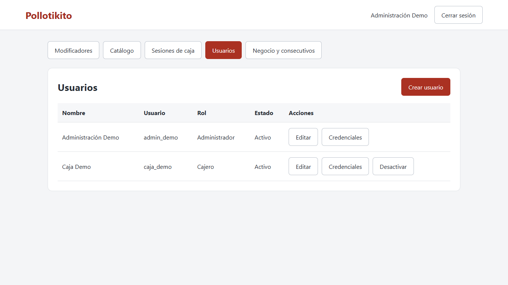

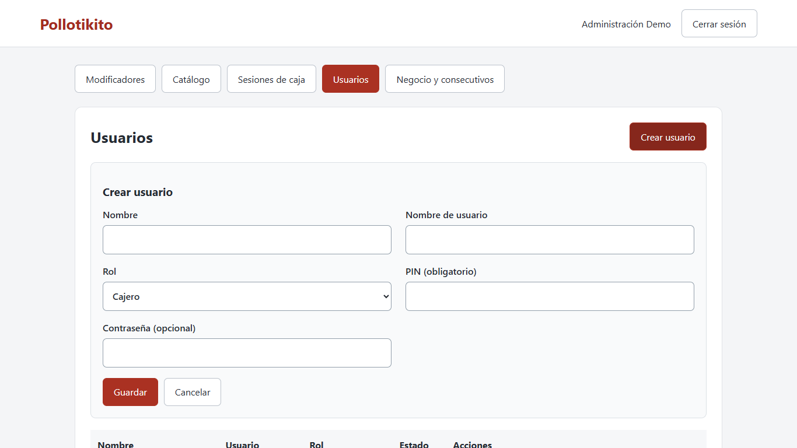

## Negocio, logo y números

En **Negocio y consecutivos**, completá nombre comercial, razón social, cédula, teléfono, correo, dirección y pie de tiquete. El IVA inicial es 13 %; el precio de los productos incluye IVA. Guardá el negocio. Para logo elegí PNG o JPG de hasta 1 MB: se conserva localmente y no necesita internet. Cambiar estos datos no altera comprobantes pasados.

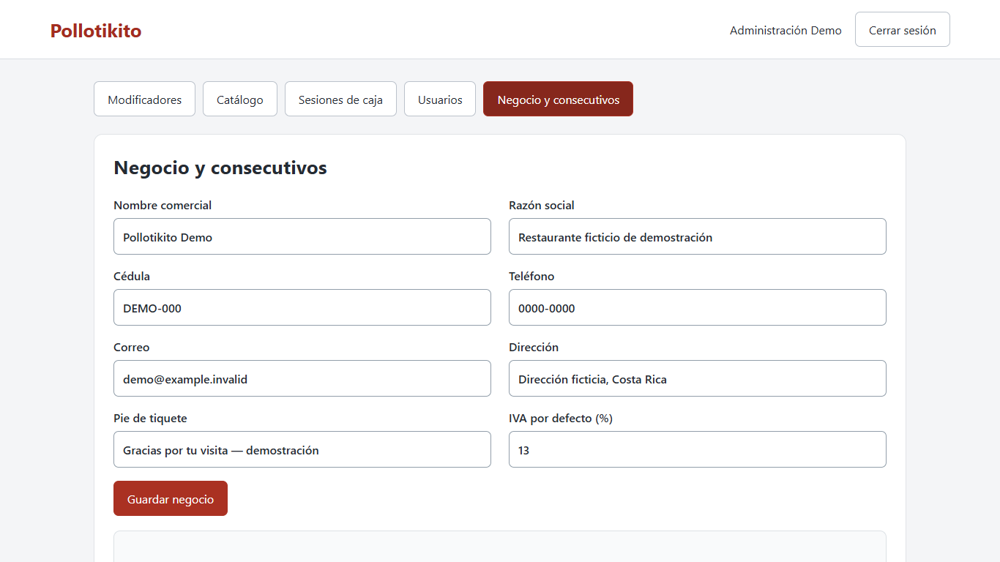

Los consecutivos TIQUETE, FACTURA y PROFORMA tienen prefijo y siguiente número. En este incremento se emiten tiquetes. Se puede cambiar el prefijo y subir el siguiente número; nunca bajarlo. El número se asigna al confirmar el cobro. No subás el número sin una razón operativa: podrían quedar saltos.

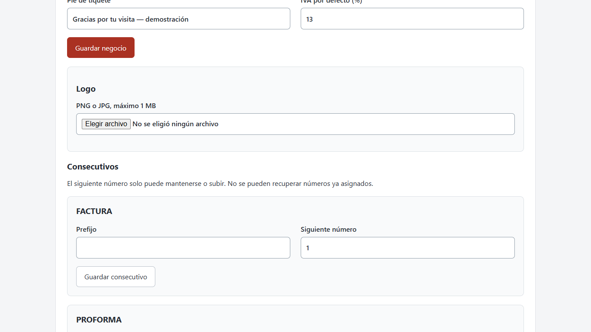

## Categorías y productos

1. En **Catálogo → Categorías**, creá nombre y orden. Menor orden aparece primero. Podés editar o desactivar.
2. En **Productos**, creá nombre, categoría, precio con IVA incluido, tarifa y orden. Foto opcional PNG/JPG máximo 1 MB.
3. Elegí descuento automático porcentual o monto por unidad y, si corresponde, fechas de vigencia. Guardá.
4. Desactivar una categoría oculta sus productos en caja aunque sigan activos. Un aviso en un producto/combо explica por qué no está disponible. Corregí la causa; el cajero no puede venderlo mientras siga el aviso.

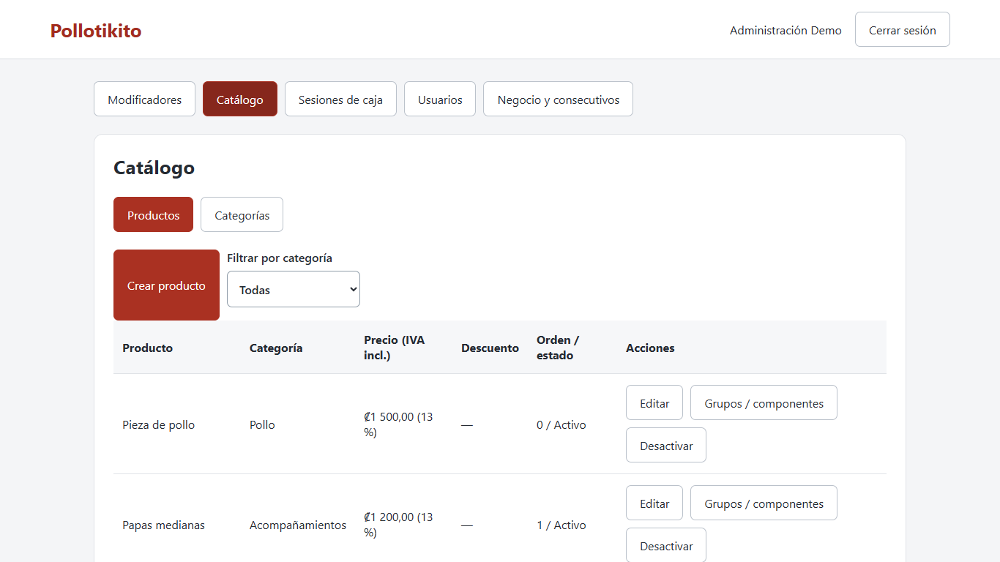

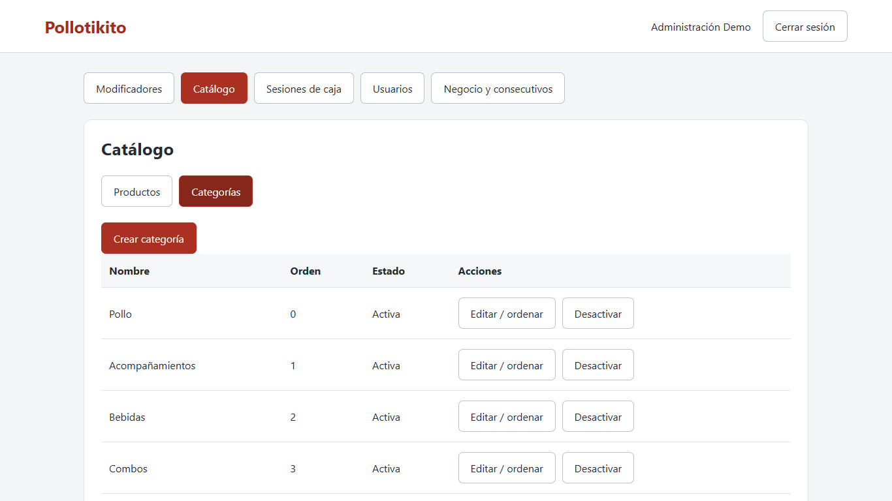

## Grupos de modificadores

1. Abrí **Modificadores → Crear grupo**. Ejemplo: «Preferencias», mínimo 0, máximo 3. Cero significa opcional; mínimo mayor que cero lo vuelve obligatorio.
2. El mínimo no puede ser negativo ni superar el máximo. El máximo es al menos 1. Elegí orden y guardá.
3. Volvé a **Editar grupo / opciones**, tocá **Agregar opción**. Ejemplos: Sin cebolla, Sin ensalada y Salsa aparte a ₡0; grupo Extras con Extra papas ₡800 y Extra queso ₡500.
4. Cambiá nombre, adicional con IVA, orden y estado al editar una opción. Desmarcar Activa/Activo y guardar desactiva sin borrar historia.
5. En **Catálogo → Productos → Grupos / componentes**, marcá los grupos que usa el producto y su orden local. Guardá elecciones. Los grupos se comparten entre productos.

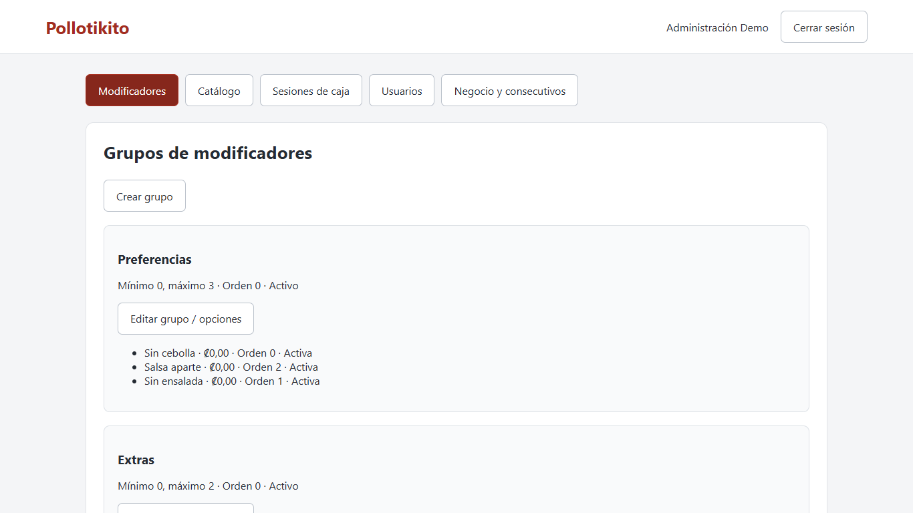

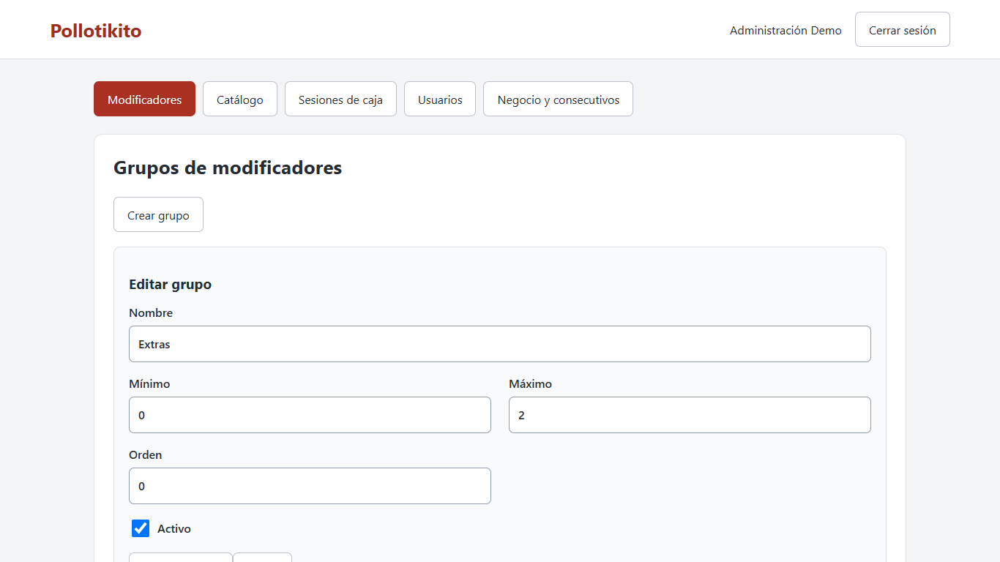

Ejemplo obligatorio: «Tipo de pieza», mínimo 1 y máximo 1, con Pecho, Muslo, Ala y Pierna. Si quedan menos opciones activas que el mínimo, el producto deja de venderse y aparece una advertencia. No es posible elegir dos veces la misma opción por línea: Extra queso se marca una vez como máximo.

## Combos

1. Creá un producto con **Es combo**, categoría, precio propio e IVA y guardalo.
2. Abrí **Grupos / componentes**. Agregá componentes por **una unidad del combo**.
3. Fijo: nombre, producto simple y cantidad. Elegible: nombre, cantidad a elegir, alternativas de productos simples y recargo individual. Ordená y guardá elecciones.
4. Ejemplo Combo 1 ₡4500: 2 piezas fijas, 1 papas medianas fija y 1 refresco a elegir entre personales; alternativa 1 litro con recargo ₡600. Extras se asignan al propio combo si se desean.
5. Combo Familiar ₡14900: 8 piezas, papas grandes, ensalada grande y refresco de 2 litros fijos.

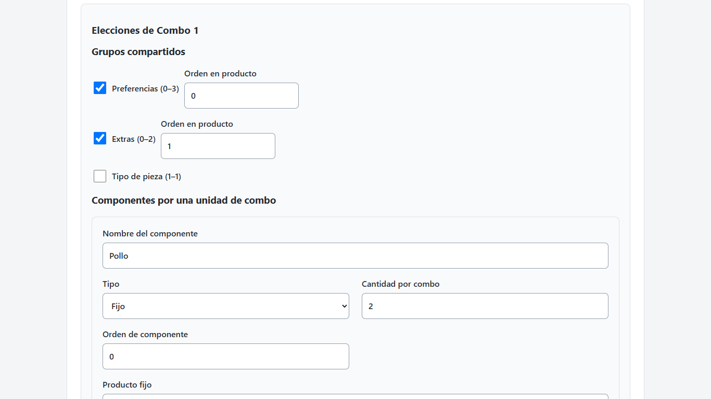

No se permiten combos dentro de combos. Tampoco podés convertir en combo un producto que otro combo usa como componente activo. Quitá primero esas referencias. Para volver un combo a simple, quitá sus componentes y guardá antes.

Si un fijo está inactivo o su categoría está inactiva, el combo no se ofrece. Lo mismo si un elegible pierde todas sus alternativas activas. La advertencia identifica el componente. Activá/corregí la referencia para recuperarlo. Los grupos de un producto usado como componente no se heredan: configurá los grupos del combo padre.

## Sesiones de caja

En **Sesiones de caja**, consultá ventas y **Reporte**. Los reportes mantienen las elecciones y precios de cada venta aunque después cambie el menú. El administrador puede forzar cierre con motivo, con conteo por denominaciones o marcando **Cerrar sin conteo**. En ese caso el reporte dice **CERRADA SIN CONTEO** y no muestra un contado o diferencia inventados. No se modifica una sesión cerrada.

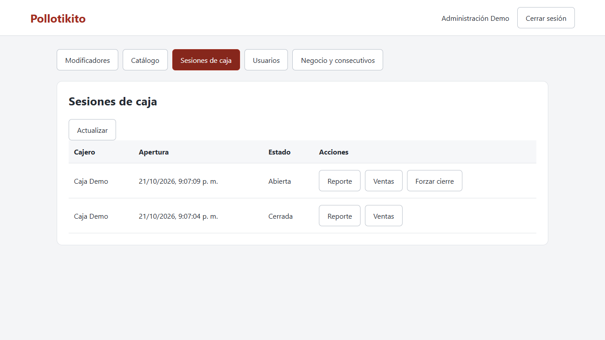

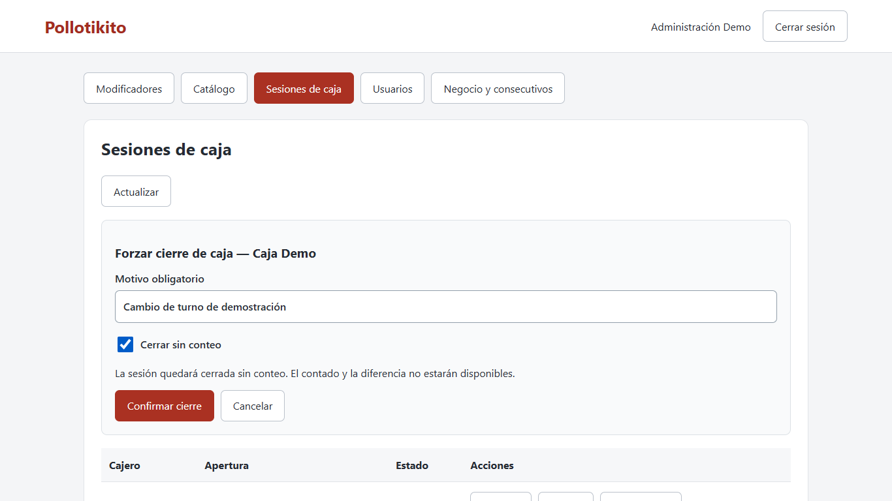

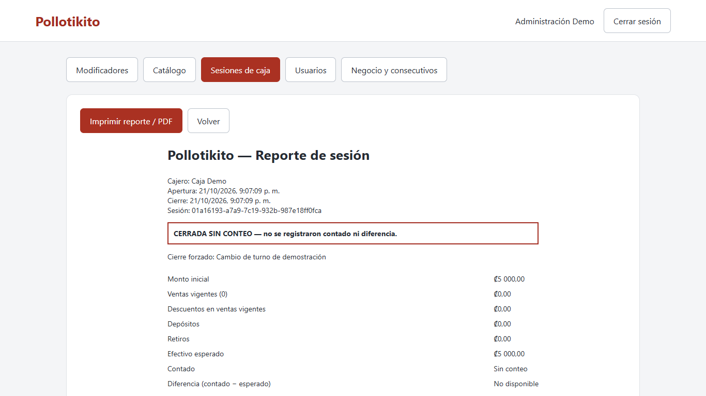
