# Trabajar en caja

## Abrir turno

Ingresá como Cajero. En **Abrir caja**, contá el dinero recibido para iniciar, escribí el **Monto inicial en efectivo** y tocá **Abrir mi caja**. Solo hay una caja abierta por sucursal; si está ocupada, pedí al responsable cerrar el turno anterior. El administrador puede forzar un cierre cuando corresponda.

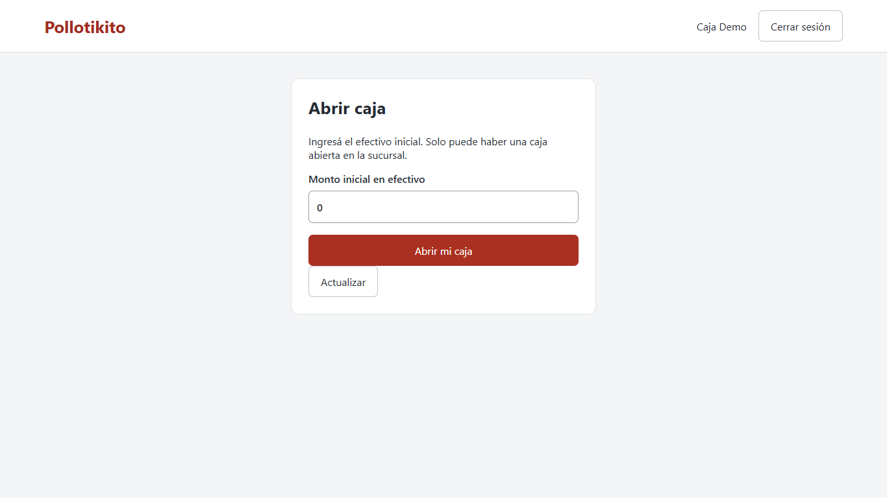

## Armar el pedido

Tocá categoría y producto. Los simples sin elecciones se agregan directamente. Usá + y − para cantidad y Quitar para sacar una línea. Agregá nota de cocina si corresponde; elegí Comer aquí, Para llevar o Express.

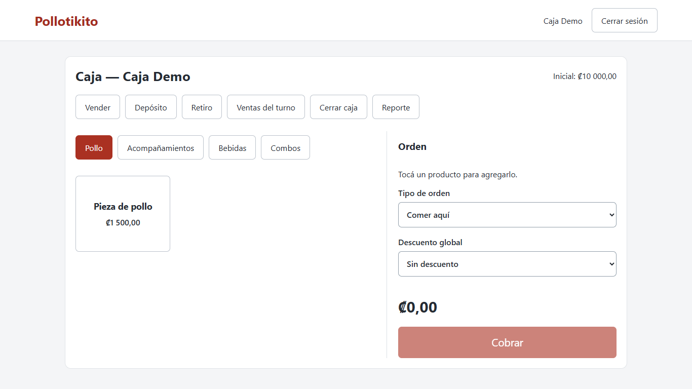

Si hay modificadores o componentes aparece **Personalizar**. Completá obligatorios y después opcionales. Las opciones muestran adicionales y límites; elegí cada refresco/pieza solicitada y confirmá elecciones. Se muestra unitario antes de descuentos; el total definitivo llega de la cotización.

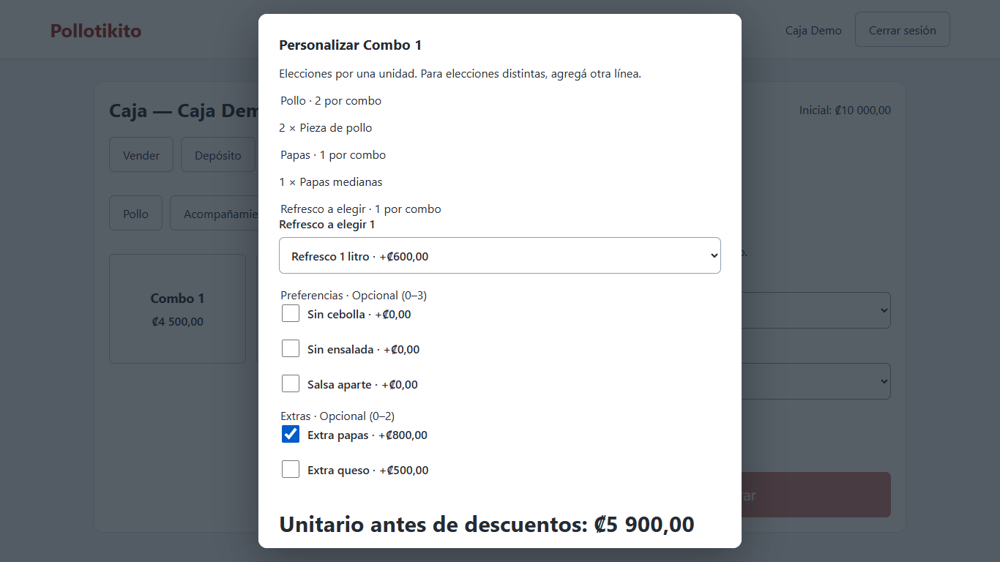

Las elecciones son por una unidad de línea. Si la cantidad es dos, ambos combos son iguales. Para otro refresco o distintas preferencias agregá otra línea. **Editar elecciones** modifica esa línea; **Repetir** agrega otra con la misma configuración. Una opción como Extra queso se marca una sola vez por línea.

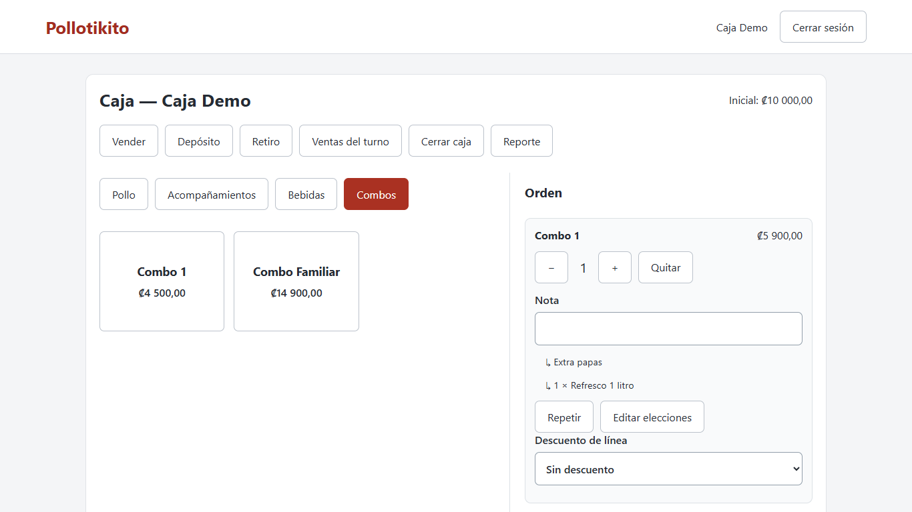

Descuentos manuales de línea o global requieren motivo. Primero se aplica el automático del producto por unidad; luego el manual de línea y después el global, repartido entre líneas. No se admiten importes negativos ni descuentos mayores al disponible. Si un producto dejó de estar disponible, el sistema rechaza cotización/cobro: quitá o corregí la línea y consultá al administrador.

## Cobrar

Tocá **Cobrar** cuando el total esté calculado.

- **Efectivo:** ingresá recibido; los botones de billetes reemplazan ese importe. Exacto usa el monto aplicado. Entregá el vuelto mostrado.
- **Tarjeta:** cobrá en el datáfono y registrá autorización. Pollotikito no opera el datáfono.
- **SINPE Móvil:** verificá el pago externo y registrá comprobante.
- **Pago mixto:** indicá las partes por método; deben sumar el total. El recibido y vuelto corresponden solo a la parte en efectivo.

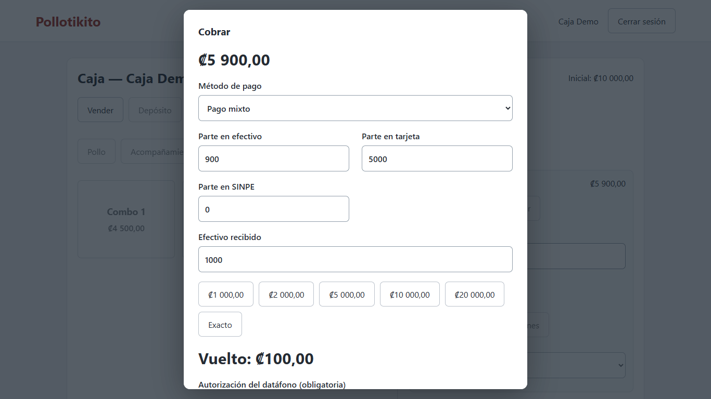

Tocá **Confirmar cobro** una vez. Si aparece pendiente, usá Consultar resultado o Reintentar mismo cobro; no armes otra venta ni repitás el cobro externo. Si muestra conflicto, pedí revisión: ese identificador ya tiene un contenido distinto.

## Tiquete e historial

Al confirmar se muestra tiquete con cantidades, componentes, modificadores, descuentos, IVA, pagos y vuelto. **Imprimir / guardar PDF** abre el diálogo del navegador. Elegí ancho 80 mm, sin encabezados/pies del navegador; no hay impresión directa ni apertura automática de gaveta. Para seguir tocá **Volver / Nueva venta**.

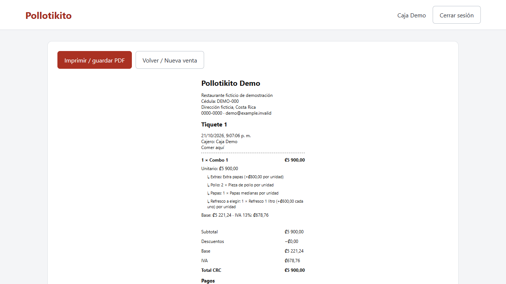

**Ventas del turno** permite buscar por número y Ver / reimprimir. Los comprobantes guardan lo vendido; cambiar el menú después no los altera.

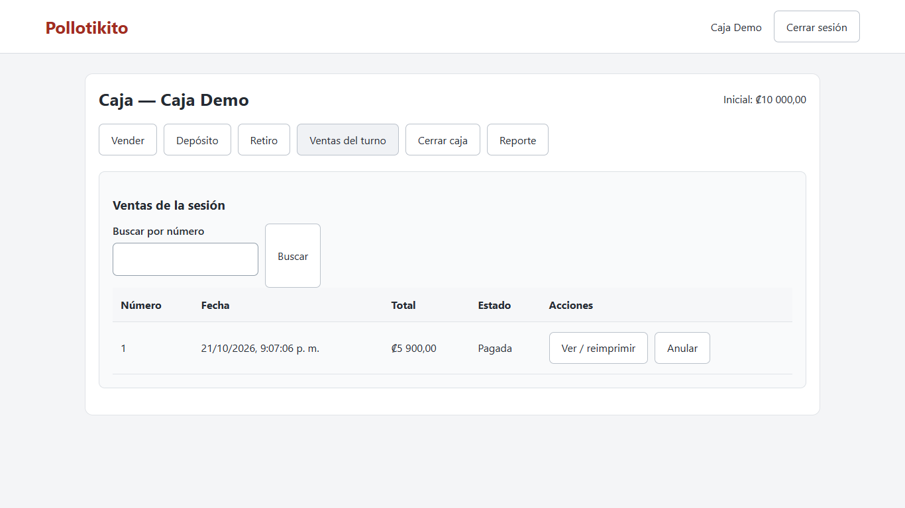

## Anular

En la venta del turno, tocá Anular, escribí motivo y confirmá. Solo podés anular en tu sesión abierta; la venta se conserva marcada anulada. Si tuvo tarjeta o SINPE aparece **Recordá reversar el cobro en el datáfono o devolver el SINPE**. Hacé esa gestión externa: el POS no devuelve ese dinero automáticamente.

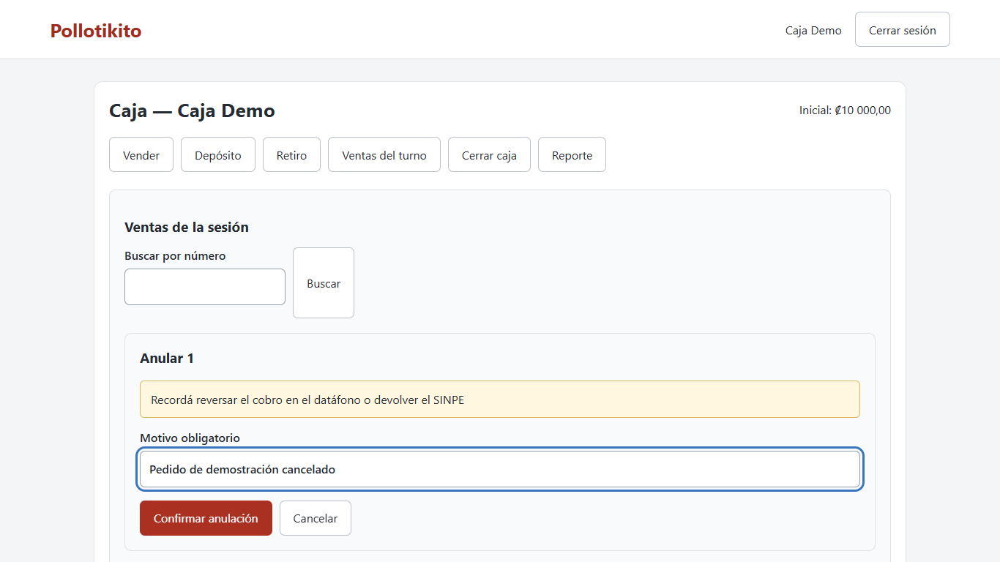

## Depósitos y retiros

**Depósito:** monto y motivo, luego Registrar depósito. **Retiro:** monto, motivo, administrador que autoriza y su PIN; luego Registrar retiro. El PIN se limpia después. La autorización es de un uso; si falla o vence, pedila de nuevo.

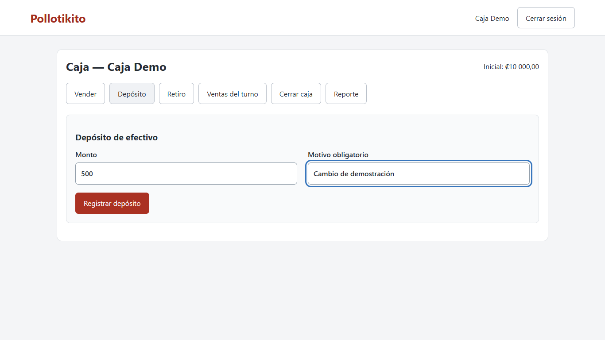

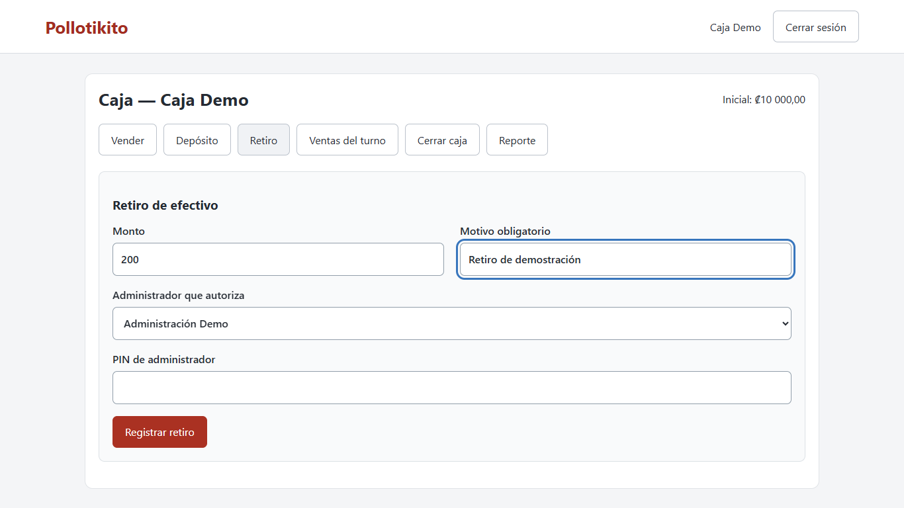

## Cerrar turno

Tocá **Cerrar caja** y contá cuántas monedas/billetes hay de cada denominación; ingresá cantidades, no montos. Revisá el contado y confirmá. La caja cerrada no admite más ventas ni cambios.

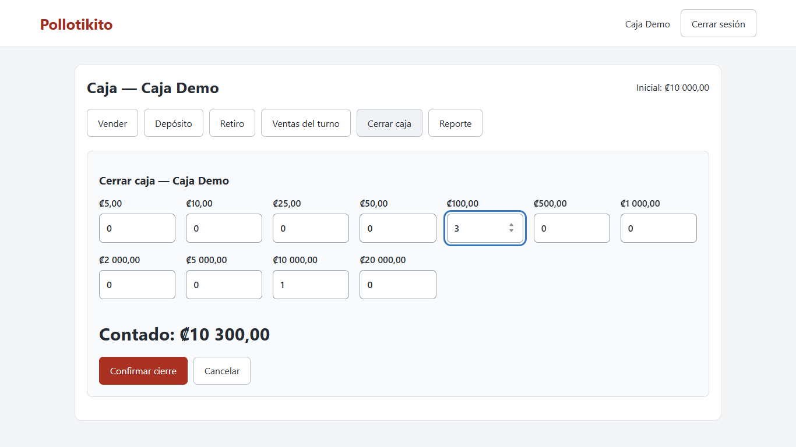

El reporte separa ventas, descuentos, anulaciones por método, depósitos y retiros. Esperado = inicial + efectivo de ventas vigentes + depósitos − retiros. Diferencia = contado − esperado. Un cierre forzado sin conteo lo indica expresamente. El reporte incluye elecciones vendidas y puede imprimirse/guardarse en carta.

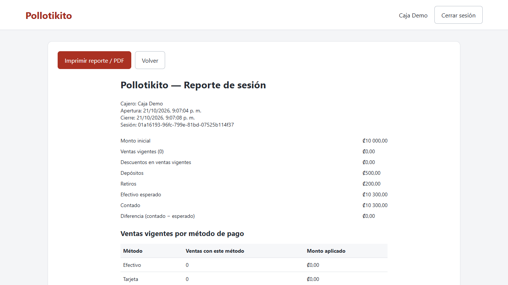

Finalmente tocá **Cerrar sesión**.
