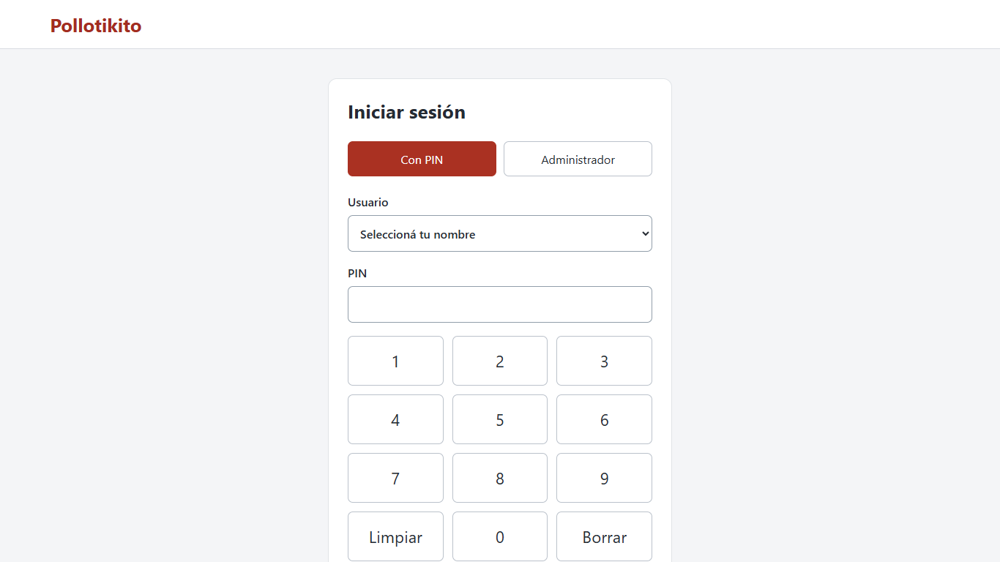
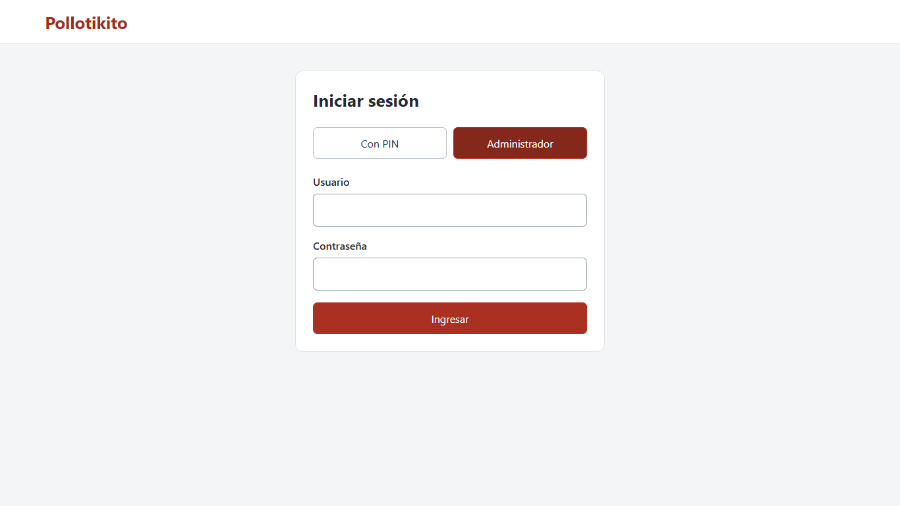
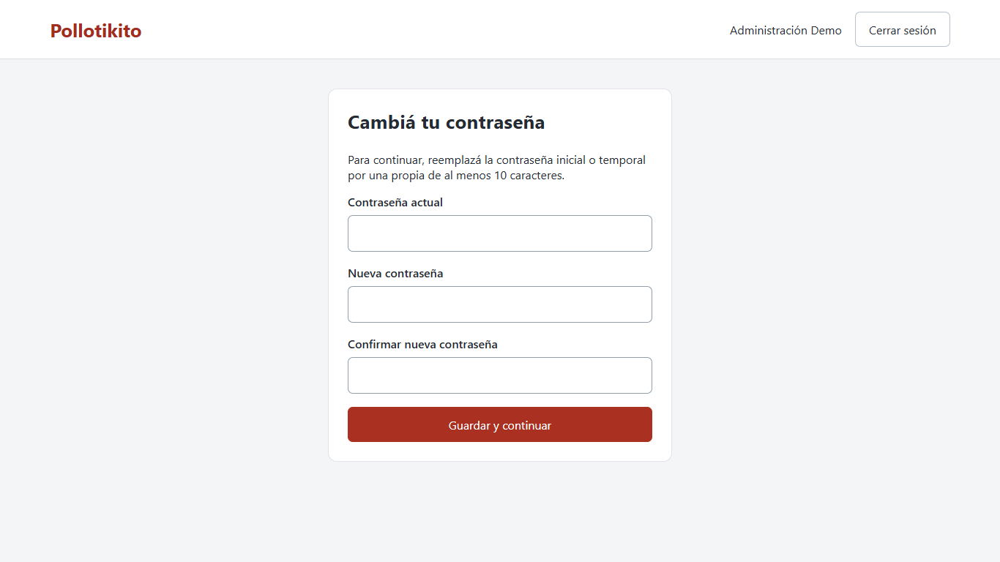

# Primeros pasos

## Encender e ingresar

1. Encendé el equipo y abrí Pollotikito en la dirección local preparada por quien instaló el sistema.
2. Para **cajero**, tocá **Con PIN**, elegí tu nombre y marcá el PIN en el teclado grande. Tocá **Ingresar**. Limpiar borra todo y Borrar quita el último dígito.
3. Para **administrador**, tocá **Administrador**, escribí tu usuario y contraseña y tocá **Ingresar**. Un administrador con PIN también puede entrar por el primer modo.

No hay una contraseña universal para el restaurante: usá la cuenta creada en tu instalación. No compartás tu PIN. Cinco intentos incorrectos bloquean la cuenta durante cinco minutos; esperá y volvé a intentar con los datos correctos.

## Primera contraseña

Si aparece **Cambiá tu contraseña**, escribí la actual, una nueva propia de al menos diez caracteres y repetí la nueva. Tocá **Guardar y continuar**. Hasta completar ese paso no se puede administrar el negocio. También aparece después de que otro administrador restablece tu contraseña.

## Elegir la tarea

Administración muestra Usuarios, Negocio y consecutivos, Catálogo, Modificadores y Sesiones de caja. El cajero ve **Abrir caja** si no tiene una abierta, o su pantalla de venta si ya la abrió. El administrador crea una cuenta con rol Cajero para operar ventas; no vende desde la administración.

Al terminar tocá **Cerrar sesión**. Cerrar sesión no cierra ni cuenta la caja: hacé el cierre de caja antes de terminar tu turno. El pedido que todavía no cobraste no se guarda al salir/recargar; si hay un cobro pendiente, primero verificá su resultado.
