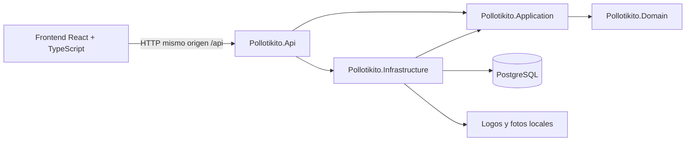

# Arquitectura

Pollotikito es un POS local de una sucursal. PostgreSQL, la API y los archivos de imágenes residen en el equipo o red local. Una instalación publicada funciona sin internet. La preparación del SDK, herramientas, paquetes npm/NuGet y navegador de capturas puede requerir descargarlos previamente.



| Carpeta | Responsabilidad |
| --- | --- |
| `Backend/Pollotikito.Domain` | Entidades y enumeraciones en español; sin dependencias de infraestructura. |
| `Backend/Pollotikito.Application` | Servicios, validación, cálculo monetario, disponibilidad e interfaces. Depende solo de Domain. |
| `Backend/Pollotikito.Infrastructure` | EF Core/Npgsql, migraciones, repositorios, transacciones, hashing y archivos. |
| `Backend/Pollotikito.Api` | Composición, HTTP, cookies, CSRF, autorización, ProblemDetails y archivos estáticos. |
| `Backend/Pollotikito.Tests` | xUnit, cálculo puro, HTTP y PostgreSQL real en esquemas aislados. |
| `Backend/Pollotikito.Demo` | Herramienta de desarrollo para preparar y eliminar datos ficticios de capturas. No se publica con la API. |
| `Frontend/src/components` | Acceso, usuarios, negocio, catálogo, modificadores, elecciones, caja y comprobantes. |

En desarrollo Vite sirve el frontend y redirige `/api` a la API. En producción `dotnet publish` incorpora `Frontend/dist` en `wwwroot`: navegador y API comparten origen y cookie. No hay JWT, CORS, CDN ni APIs externas.

## Flujo de venta

```mermaid
sequenceDiagram
  participant C as Cajero React
  participant H as API HTTP
  participant A as Application
  participant I as Infrastructure / PostgreSQL
  C->>H: Cotizar líneas y elecciones con cookie + CSRF
  H->>A: Validar sesión, rol y entrada
  A->>I: Leer catálogo vigente
  A-->>C: Precio completo, descuentos y total
  C->>H: Cobrar UUID v7, elecciones y pagos
  H->>A: CobrarVenta
  A->>I: BEGIN, UUID existente y sesión FOR UPDATE
  A->>I: Releer catálogo y recalcular
  A->>I: Consecutivo UPDATE RETURNING
  A->>I: Guardar venta, instantáneas, pagos y auditoría; COMMIT
  A-->>C: VentaDto confirmada
  C->>C: Mostrar tiquete / impresión del navegador
```

El [flujo transaccional detallado](ventas-y-caja.md) explica reintentos idénticos, conflictos y rollback.

Las mutaciones administrativas usan la transacción administrativa existente. Las operaciones de caja usan transacciones y bloqueo de fila de la sesión, sin bloqueo global. Los contratos y reglas viven en Application; la UI nunca determina el precio final.

## Alcance

I1: seguridad, auditoría, negocio y consecutivos. I2: catálogo básico, caja, cobro y comprobantes. I3: grupos compartidos, modificadores y combos. Inventario, clientes, crédito, correo, nube, impresión térmica directa y comanda siguen pendientes. La impresión actual abre el diálogo del navegador.

Ver [base de datos](base-de-datos.md), [ventas y caja](ventas-y-caja.md), [seguridad](seguridad.md), [decisiones](decisiones.md), [pruebas](pruebas.md) y [operación](operacion.md).
