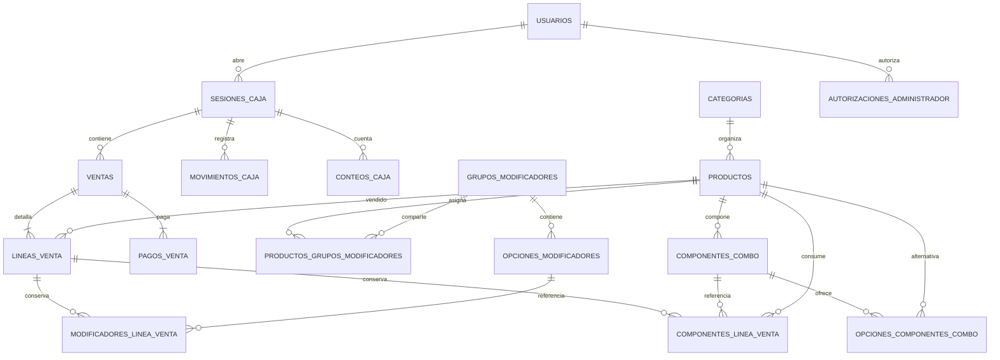

# Base de datos

Todas las tablas de negocio tienen `id uuid` generado con `Guid.CreateVersion7()`, `sucursal_id uuid`, `creado_en` y `actualizado_en` UTC (`timestamp with time zone`). Tablas/columnas en snake_case. Dinero CRC `numeric(18,2)`; IVA con precisión propia. Ninguna tabla de elecciones guarda JSON; la bitácora usa `jsonb` para valores anterior/nuevo.



## Tablas y datos principales

| Tabla | Datos / integridad |
| --- | --- |
| usuarios | Nombre/login normalizado único, rol, hashes, activo, intentos, bloqueo, DebeCambiarCredenciales, versión de seguridad. |
| configuracion_negocio | Registro único; nombre, razón social, cédula, teléfono/correo, dirección, logo relativo, pie, IVA 13 inicial. |
| consecutivos | Tipo único TIQUETE/FACTURA/PROFORMA, prefijo y siguiente positivo; no puede bajar. |
| bitacora | Usuario nullable, acción, entidad/id, JSON anterior/nuevo, fecha UTC e IP. Solo inserción. |
| autorizaciones_administrador | Hash token, administrador, solicitante, acción, vencimiento y consumo. |
| categorias / productos | Nombre, orden y activo; producto con categoría, precio, IVA, foto, descuento/vigencia y EsCombo. |
| grupos_modificadores | Nombre, mínimo, máximo, orden, activo; restricción de límites. |
| opciones_modificadores | Grupo, nombre, precio adicional no negativo, orden, activo. |
| productos_grupos_modificadores | Producto/grupo único; orden local, activo. |
| componentes_combo | Combo padre, nombre, tipo fijo/elegible, cantidad por unidad, producto fijo nullable, orden, activo. |
| opciones_componentes_combo | Componente/producto único, recargo no negativo, orden y activo. |
| sesiones_caja | Propietario, inicial, apertura/cierre, responsable, motivo, indicador sin conteo, esperado/contado/diferencia. Índice único parcial abierta por sucursal. |
| ventas | Sesión, cajero, consecutivo, hash de solicitud, orden/estado, totales, datos históricos del negocio, anulación. |
| lineas_venta | Producto y nombre histórico, cantidad, precio, descuentos/motivo, IVA, base, impuesto y total. |
| modificadores_linea_venta | Línea, grupo/opción originales, nombres históricos, precio adicional por unidad y orden. Único línea/opción. |
| componentes_linea_venta | Línea, componente/producto originales, nombres, cantidad por unidad de combo y recargo unitario históricos, orden. |
| pagos_venta | Método, aplicado, recibido/vuelto y referencia externa. |
| movimientos_caja / conteos_caja | Depósito/retiro con motivo; denominación y cantidad al cierre. |

FK `Restrict` preservan referencias. Catálogo se desactiva: opciones, asignaciones, componentes y alternativas no se borran al editar; permiten referencias desde ventas pasadas. Cambiar configuraciones no actualiza instantáneas vendidas.

## Migraciones versionadas

`Persistence/Migrations`: BaseSistema, Protecciones, VenderYCuadrarCaja, ProteccionesCaja, MenuCompleto y ProteccionesMenu. Las protecciones SQL incluyen inmutabilidad de bitácora, prohibición de borrar usuarios/catálogo básico, monotonicidad de consecutivos, inmutabilidad tras cierre y bloqueo de combos anidados. Las instantáneas de elecciones rechazan UPDATE/DELETE y nuevas inserciones en sesiones cerradas.

Development aplica migraciones al arrancar. Producción las aplica explícitamente con EF; respaldar antes y conservar imágenes y configuración. Las migraciones SQL de I3 se verificaron en los esquemas temporales de pruebas y demo; `has-pending-model-changes` confirma que el snapshot congelado coincide con el modelo. No se desactiva esa comprobación en EF.

Las pruebas usan esquemas `test_pollotikito_<uuid>`. Las capturas usan `demo_pollotikito_<uuid>` solo dentro de `pollotikito_test`. No hay DROP DATABASE automatizado. Ver [pruebas](pruebas.md) y [operación](operacion.md).

## Agregar y aplicar una migración

Configurar `ConnectionStrings__Pollotikito` para la base local de destino, sin publicar su contraseña:

```powershell
dotnet tool restore
dotnet ef migrations add NombreDelCambio --project Backend/Pollotikito.Infrastructure --startup-project Backend/Pollotikito.Api --output-dir Persistence/Migrations
dotnet ef migrations has-pending-model-changes --project Backend/Pollotikito.Infrastructure --startup-project Backend/Pollotikito.Api
dotnet ef database update --project Backend/Pollotikito.Infrastructure --startup-project Backend/Pollotikito.Api
```

Revisar el SQL generado y versionar migración, diseñador y snapshot. Para triggers/protecciones usar una migración SQL explícita con su reversión. Probar instalación desde cero y actualización antes de despliegue; no editar migraciones ya aplicadas en otras instalaciones.
