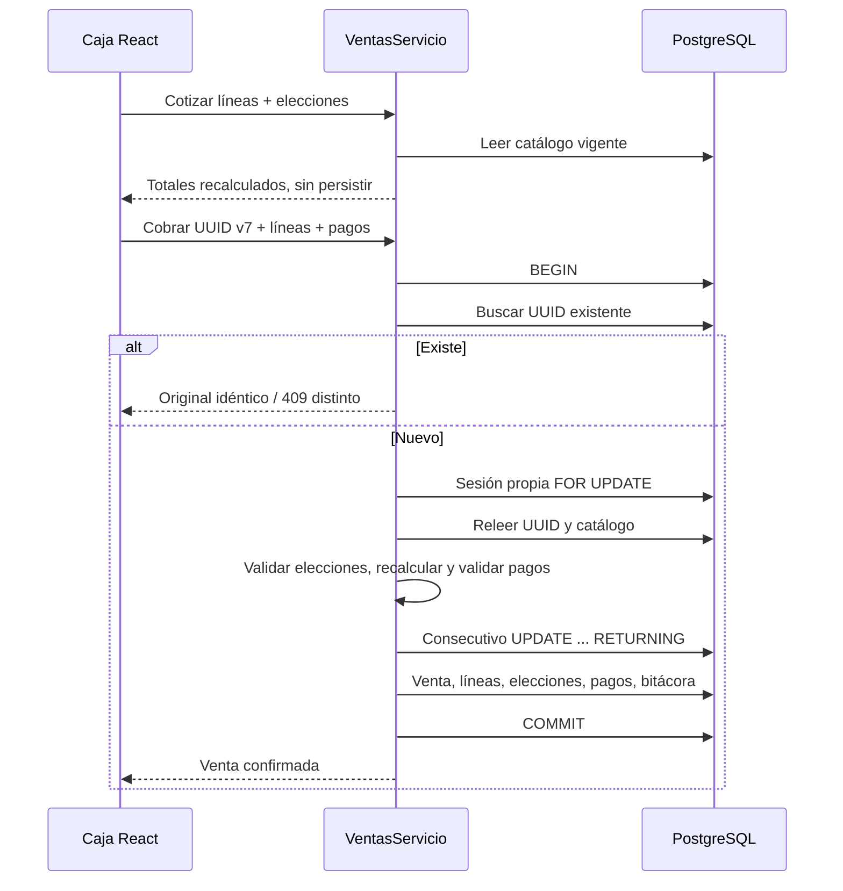

# Ventas y caja

## Cotización y cobro

El cajero necesita una sesión propia abierta. El servidor obtiene el catálogo actual, verifica productos, categorías, componentes y opciones; calcula y guarda instantáneas. Los precios o totales enviados por el navegador no son autoridad.

Una línea representa una configuración por unidad. Cantidad 3 repite tres veces sus elecciones; configuraciones distintas van en líneas separadas. Repetir crea otra línea con las mismas elecciones. Cada opción de modificador se admite una vez por línea. Los componentes elegibles requieren exactamente su cantidad configurada; se agrupan por producto elegido, sin repetir pares componente/producto.

Disponibilidad: producto y categoría activos; cada grupo obligatorio asignado activo y con suficientes opciones activas para su mínimo; combos con al menos un componente activo, todos los fijos apuntando a productos simples activos de categorías activas y cada elegible con alguna alternativa activa. Los productos no disponibles se excluyen de caja y se rechazan tanto al cotizar como al cobrar. Administración recibe `advertencias` con la causa. Un componente se consume como producto simple: sus grupos propios no se heredan al combo; los grupos del combo se asignan al combo.

## Cálculo monetario exacto

1. Unitario completo = precio del producto/combо + suma de opciones de modificador + suma de recargo unitario de alternativa × cantidad de esa alternativa por combo. Fijos no agregan su precio de catálogo.
2. Automático por unidad: porcentaje redondeado a centavos o monto limitado al unitario; se multiplica por cantidad. Vigencia UTC inclusiva.
3. Manual de línea sobre el importe restante; exige motivo. Un descuento que excede el disponible se rechaza.
4. Global prorrateado proporcionalmente entre líneas: cuotas inferiores en centavos, resto distribuido por mayores restos con desempate por orden de línea. Exige motivo y no genera importes negativos.
5. Por línea: `base = Round(total / (1 + tarifaIVA / 100), 2, AwayFromZero)`; `impuesto = total - base`. Venta = sumas de sus líneas. Todo el unitario, incluidos adicionales, usa la tarifa del producto vendido.

Ejemplo: Combo 1 ₡4500 + papas ₡800 + refresco 1L ₡600 = ₡5900. Dos unidades: ₡11800 antes de descuentos. Con automático 10 % por unidad: ₡10620; manual de línea ₡620: ₡10000; global ₡1000 para esta única línea: ₡9000. IVA incluido 13 %: base ₡7964,60 e impuesto ₡1035,40.

`decimal` en C# y `numeric(18,2)` en PostgreSQL; CRC. El cálculo React del modal es orientativo; la cotización y el cobro del servidor confirman el resultado.

## Idempotencia y concurrencia

La huella SHA256 incluye sesión, orden, notas, cantidades, descuentos, pagos y elecciones. Normaliza números, ordena IDs de modificadores y pares componente/producto; conserva el orden de líneas y pagos. Las solicitudes sin elecciones conservan la huella de I2. Reintento idéntico del mismo cajero devuelve el original aunque cambió el catálogo o se cerró la sesión; UUID ya usado con otro contenido/usuario devuelve 409.

El frontend retiene una solicitud pendiente exacta en memoria y `sessionStorage` de esa pestaña, sin credenciales. No permite editarla mientras espera confirmación. Consultar UUID o reintentar el mismo cobro; no volver a cobrar externamente.

`IConsecutivos.Siguiente` ejecuta `UPDATE ... RETURNING` dentro de la transacción del cobro. Fallar el cobro revierte también el número; anular una venta confirmada no lo libera. No hay endpoint público para solicitar números. Editarlos solo permite mantener o subir el siguiente número. El índice único parcial impide dos sesiones abiertas para la sucursal. Cobros, retiros, depósitos, anulaciones y cierres bloquean la sesión con `FOR UPDATE`; no toman el bloqueo asesor administrativo.

## Pagos, anulaciones y cierre

Cada método aparece una vez como máximo. La suma de montos **aplicados** coincide con el total. Efectivo: recibido ≥ aplicado, vuelto = recibido − aplicado. Tarjeta requiere autorización y SINPE comprobante; el POS solo registra esos cobros externos.

Anular exige sesión propia abierta y motivo; mantiene pagos, líneas y elecciones. Para tarjeta/SINPE: **Recordá reversar el cobro en el datáfono o devolver el SINPE**. El reporte separa anulaciones por método; en mixtos cada método muestra solo su parte.

`Esperado = inicial + efectivo recibido − vuelto de ventas vigentes + depósitos − retiros`. `Diferencia = contado − esperado`. Retiro exige token de administrador para `retiro_efectivo`; depósito no. Cierre normal por propietario con conteo. Administrador puede forzar con motivo y con/sin conteo: sin conteo guarda indicador y contado/diferencia nulos. Una sesión cerrada queda protegida por triggers, incluidas sus instantáneas de elecciones.

Tiquete de 80 mm y reporte carta mediante navegador. Ambos muestran componentes y modificadores indentados con nombres y precios históricos. El reporte incluye el detalle de ventas, incluidas anuladas, además de sus agregados.

## Guía para el descuento de inventario — Incremento 4

No releer la definición vigente del combo para reconstruir una venta histórica. Para cada `LineaVenta`:

- Producto simple, sin componentes: consumir su `ProductoId` con cantidad `LineaVenta.Cantidad` y resolver su receta.
- Combo: recorrer `ComponenteLineaVenta`, que contiene **todos los fijos y elegidos**. Para cada fila, consumir `ProductoId` por `CantidadPorUnidad × LineaVenta.Cantidad`. Agrupar por producto después de expandir todas las líneas.
- Dos combos con fijo dos piezas y elegible una bebida consumen cuatro piezas y dos bebidas elegidas. Tres combos de ese mismo tipo consumen seis piezas y tres bebidas.
- `RecargoUnitario` es precio, no cantidad física. No descontar además el producto padre del combo: duplicaría consumo.
- Los modificadores conservan IDs y nombres/precios, pero aún no relacionan insumos ni recetas. I4 tendrá que definir ese vínculo explícito si un extra consume inventario; no inferirlo del texto «Extra papas» ni de su precio.

I4 deberá registrar movimientos de inventario e inversión al anular en la misma transacción del documento, con idempotencia, sin modificar estas instantáneas. Recetas y movimientos no se implementan en I3.
